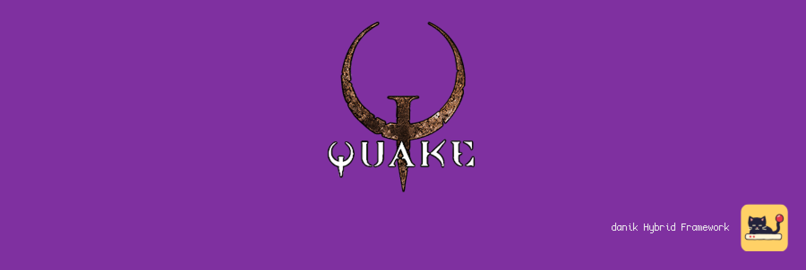

# ChocolateQuake for MiSTer

Quake and its mission packs, Scourge of Armagon and Dissolution of Eternity, on [MiSTer FPGA](https://github.com/MiSTer-devel/Main_MiSTer/wiki) as a hybrid port.

The game itself is [Chocolate Quake](https://github.com/Henrique194/chocolate-quake), a source port that keeps Quake as version 1.09 played it, software renderer and all. It runs on the MiSTer's ARM CPU. The ChocolateQuake FPGA core provides native 15kHz video (CRT, VGA and HDMI) at 320x200, 640x200, 320x240 or 640x240, 44.1kHz audio and keyboard, mouse and gamepad input. The two halves talk through shared DDR3 memory.

> **Beta.** Expect rough edges and please report problems in the issues.
>
> **Disclaimer:** AI is being extensively used to speed up development, but the project is well-maintained and supported.

  
  

## Requirements

- **danik_hybrid_ports**, the launcher (`Scripts/danik_hybrid_ports.sh`): run it **once** from the MiSTer's `Scripts` menu. It starts the game whenever its menu entry is loaded, keeps running after a reboot, and serves all our hybrid ports; its screen picks which ports and games to have, and can keep them up to date through `update_all`. Without it the core says "Game not running".
- **Game data**, which is not included: your own copy of Quake (CD, Steam or GOG) and, to play them, of its mission packs, or the shareware episode.
- **Recommended:** a gamepad with two analog sticks and analog triggers, like an Xbox or PlayStation controller. A gamepad without them works but is not recommended. The game can also be played with a keyboard and mouse.

## Installation

With `update_all` (Downloader 2.4 or newer, which update_all keeps up to date):

1. Copy [`downloader_danik_hybrid_ports.ini`](https://raw.githubusercontent.com/ItsDanik/Hybrid_MiSTer/main/launcher/downloader_danik_hybrid_ports.ini) to the root of your SD card (`/media/fat`).
2. Run `update_all`. That installs the launcher, **danik_hybrid_ports**, in `Scripts`.
3. Run **danik_hybrid_ports** from the `Scripts` menu, tick the games you want and press *X: Apply*. They are installed, and update_all keeps them up to date.
4. Copy your game's folders to `/media/fat/games/dnk/ChocolateQuake/`, each whole, with **everything** in it, all the files as they are (upper or lower case does not matter). Each game is known by its folder:

   | Game | Folder |
   |---|---|
   | Quake | `id1`, with `pak0.pak` and `pak1.pak` |
   | Quake shareware | `id1`, with `pak0.pak` alone |
   | Scourge of Armagon | `hipnotic`, next to the full game's `id1` |
   | Dissolution of Eternity | `rogue`, next to the full game's `id1` |

   From Steam or GOG, where Quake is the 2021 re-release, copy the folders of the install folder itself (`Quake/id1`, and `hipnotic` and `rogue` where it has them), not those in its `rerelease` folder: the re-release's own files are made for its new engine and do not run here.

   The music, where your copy has it as files (`music/track02.ogg` and on, Ogg Vorbis, MP3, FLAC or WAV), comes with the folder it is in.
5. Load the game from the `Other` menu, e.g. **dnk-Quake**.

> [!NOTE]
> The game data can go on a USB drive instead, into the same folder there (`/media/usb0/games/dnk/ChocolateQuake/`): the game looks for it there first, and then keeps its settings and saved games there as well. Everything else stays on the SD card.

The menu entry of Quake starts the shareware when the full game is not there; the mission packs need the full game. When a game's files are missing, the core says which files to copy where. Each game keeps its own OSD settings and button mappings. The core file itself (`_Other/dnk/dnk-ChocolateQuake_*.rbf`, or from *Recent*) lists the games that are there to pick from; quitting a game then returns to the list. The game's log is in `/media/fat/logs/dnk/ChocolateQuake/chocolatequake.log`; its settings (`config.cfg`) and saved games are in the game's folder (`id1`, `hipnotic` or `rogue`).

## OSD options

| Option | |
|---|---|
| Aspect ratio, Scale, Scandoubler Fx, Stereo Mix | as in other cores |
| FPS Counter | shows the pictures per second in the top left corner |
| HDMI Only | as in the other hybrid ports, for resolutions of 640x400 and more: ChocolateQuake has none, so nothing changes here |
| CRT Options | **Horizontal Size**: the picture's width **Horizontal Pos**: moves it left or right **Vertical Pos**: moves it up or down **HUD (Top)**: moves the game's messages 0 to 24 lines down from the top edge (default 0), at 240 lines **HUD (Bottom)**: lifts the status bar 0 to 24 lines off the bottom edge (default 0), at 240 lines  For a 15kHz screen: fits the picture to it and keeps the HUD out of the overscan. HDMI is not affected; not there with `forced_scandoubler=1` |
| Resolution | **320x200**: as the original (default) **640x200**: twice the detail across, same picture size **320x240**: the view fills the whole screen **640x240**: both  Always at 15kHz. With 240 lines the status bar and the messages are drawn over the view at the HUD margins; the menus stay at the top, as in the original. Applies at once |
| Rumble | **On** (default) **Strong**: harder **Off**  The gamepad rumbles when you are hit, fire, land hard or something explodes nearby |
| Cheats | **God Mode**: nothing hurts you **No Clipping**: fly through walls **Invisible to Monsters**: monsters do not see you **All Weapons and Keys**: every weapon, full ammo and the keys **Quad Damage**: 30 seconds of Quad Damage **Full Health and Armor**: 100 health and red armor **Next Level**: completes the level  In single player |
| Save Diagnostic Report | the last line: see [If something is wrong](#if-something-is-wrong) |

## Controls

- **Keyboard and mouse:**

| Key | Action |
|---|---|
| Up, down | Walk forward, back |
| Left, right | Turn |
| `,` and `.` | Strafe left, right |
| Mouse | Turn, and walk forward and back; hold the middle button (or `\`) to look up and down instead |
| Left mouse button (or Ctrl) | Attack |
| Space (or Enter) | Jump, swim up |
| C | Swim down |
| Left Shift | Run |
| 1-8, `/` | Pick a weapon, next weapon |
| A, Z | Look up, down (End: straight ahead) |
| Tab | Scores |
| F6, F9 | Quicksave, quickload |
| `~` | Console |
| Esc | Menu |

- **Gamepad** (default mapping):

| Button | Action |
|---|---|
| Left stick | Walk and strafe |
| Right stick | Look around |
| D-pad | Walk and turn |
| R (RB / R1), R2 | Attack |
| L (LB / L1), L2 | Run |
| A (Xbox B / PlayStation Circle) | Jump, swim up |
| B (Xbox A / PlayStation Cross) | Swim down |
| X (Xbox Y / PlayStation Triangle) | Next weapon |
| Y (Xbox X / PlayStation Square) | Previous weapon |
| R3 (right stick click) | Look straight ahead |
| Select | Scores |
| Start | Menu |

Change the buttons in the OSD under *Define ChocolateQuake buttons*. *Menu OK* and *Menu Back* there are only needed for a spare button without a game function. While the OSD is open, the game gets no input.

> [!WARNING]
> A button left without a name in *Define ChocolateQuake buttons* does not reach the game at all, except L2/R2, L3/R3 and *Menu OK* / *Menu Back*. Name every button there, or leave the definition as it is. To go back to the default buttons, delete `config/inputs/ChocolateQuake_*_input_*_v3.map` (each game has its own) on the SD card.

The game's own menu can change what each gamepad button does: *Options*, *Customize controls*. Change the actions there rather than in the OSD; a button the OSD leaves without a name never reaches the game, so its menu cannot bind it.

## If something is wrong

If the game stutters, the sound breaks up or something else is wrong, open the OSD while it happens and pick **Save Diagnostic Report**, the last line of the menu. The game keeps running; MiSTer's info box says the report is saved in `games/dnk/diagnostics/` on the SD card. Send that file (`ChocolateQuake_<date>_<time>.zip`) with a few words on what went wrong.

The report has the setup (versions, the video and audio lines of `MiSTer.ini`, the OSD settings), how the last 60 seconds went, the game's log and a screenshot. Nothing else: no network settings, addresses, saved games or lists of your files.

## Building

How the port works, how to build it and notes for development: [NOTES.md](NOTES.md).

## Support

If you enjoy this project, you can support my work on [Patreon](https://www.patreon.com/itsdanik).

## Credits

- **[Chocolate Quake](https://github.com/Henrique194/chocolate-quake)** by Henrique Barateli and contributors, based on the Quake source by id Software.
- **[SDL](https://libsdl.org)** by Sam Lantinga and contributors; the music is decoded with stb_vorbis by Sean Barrett, dr_flac by David Reid and minimp3 by lieff, as SDL_mixer brings them.
- **[MiSTer](https://github.com/MiSTer-devel)** by Sorgelig and the MiSTer-devel contributors: the framework and Template_MiSTer.
- **[MiSTer Frontier](https://github.com/MiSTerOrganize/MiSTer_Frontier)** by MiSTer Organize: thank you for the inspiration. Hybrid cores on the MiSTer, and the way their game is launched (a daemon that watches the loaded core and runs a script from its games folder), were inspired by MiSTer Frontier.

This project and its maintainers are in no way associated with or endorsed by id Software, Hipnotic Interactive (Ritual Entertainment), Rogue Entertainment, Bethesda or ZeniMax. It does not include any game data.

## License

The top-level scripts, tools and documentation are licensed under the [GPL-3.0](LICENSE). The components keep their own licenses: the part of the shared framework the game is linked with (`hybrid/hps/`) is GPL-2.0-or-later, the rest of `hybrid/` GPL-3.0 except where its files say otherwise, Chocolate Quake is GPL-2.0-or-later (`chocolatequake/LICENSE`) with music decoders that are public domain, MIT-0 and CC0, SDL and the SDL drivers in `hybrid/sdl2` are zlib, the FPGA core and the MiSTer framework are GPL-2.0 (`core/LICENSE`, with the core's own sources GPL-2.0-or-later).
